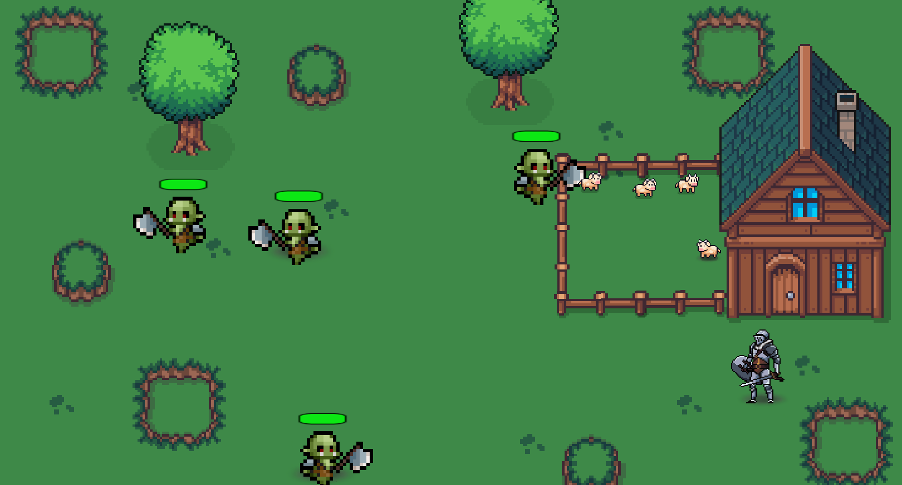
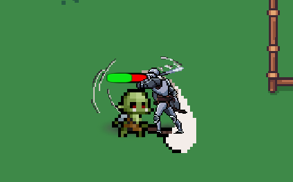
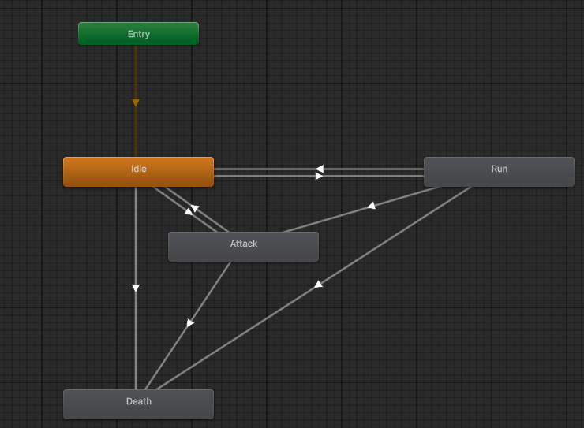
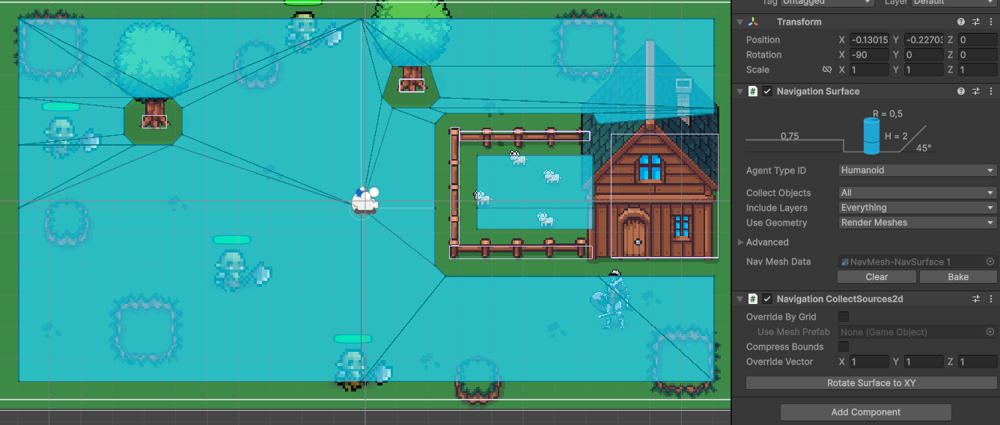
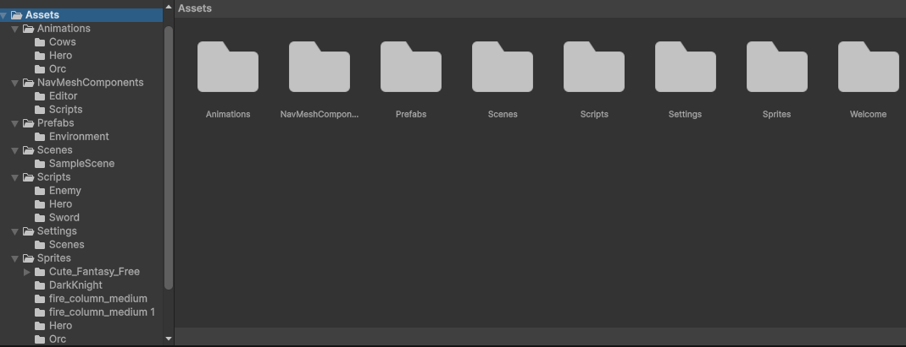

# 2D Adventure

Учебный проект по разработке 2D-игр в Unity.

> Это демонстрационный учебный проект, который показывает, какие элементы разработки игр можно изучать с детьми в Unity. Полноценную игру со сложной сюжетной частью и большим количеством контента делать с детьми значительно сложнее, поэтому в проекте основное внимание уделено отдельным игровым механикам и принципам разработки.

## О проекте

Проект представляет собой небольшую 2D adventure-игру в стиле pixel-art.

Игрок управляет рыцарем, исследует игровую карту и сражается с противниками. На сцене присутствуют препятствия, через которые персонажи не могут проходить, а противники самостоятельно перемещаются по игровому миру и преследуют героя.

В проекте реализованы основные механики, которые позволяют показать полный цикл создания небольшой 2D-игры в Unity: от добавления и настройки ассетов до программирования персонажа, противников, боевой системы, анимаций и взаимодействия объектов.

## Что изучается в проекте

В процессе работы над подобным проектом ребёнок знакомится не только с визуальной частью игры, но и с основными принципами разработки:

- создание сцены и игровой карты;
- работа с GameObject и компонентами Unity;
- добавление и настройка готовых ассетов;
- работа со Sprite Renderer;
- настройка Collider и Rigidbody;
- работа с физикой и столкновениями;
- создание управления персонажем;
- программирование игровой логики на C#;
- создание и настройка анимаций;
- работа с Animator;
- взаимодействие персонажей и объектов;
- создание системы здоровья;
- реализация атаки и получения урона;
- создание поведения противников;
- работа с NavMesh для перемещения NPC;
- настройка отображения объектов относительно друг друга;
- поиск и исправление ошибок в игровом проекте.

## Основные механики

### Управление героем

Игрок управляет рыцарем с помощью клавиатуры.

Герой может перемещаться по игровой карте и атаковать противников.

Во время движения используется анимация ходьбы, а при атаке запускается соответствующая анимация.

### Противники

На карте находятся противники, которые самостоятельно перемещаются по сцене.

Для навигации используется NavMesh. Благодаря этому NPC могут находить путь по игровой области и перемещаться с учётом препятствий.

При обнаружении героя противник может начать преследование и атаковать его.

### Система боя и здоровья

В проекте реализована система взаимодействия героя и противников.

У героя и NPC есть запас здоровья. Во время атаки персонаж может нанести урон другому персонажу, после чего его здоровье уменьшается.

У противников отображается полоска здоровья, которая показывает текущее состояние персонажа.

Если здоровье персонажа полностью заканчивается, он погибает.

Таким образом, боевая система включает:

- атаку героя и противников;
- определение попадания;
- нанесение урона;
- уменьшение здоровья;
- отображение полоски здоровья;
- проигрыш персонажа.

## Столкновения и физика

Для объектов игрового мира используются Collider и Rigidbody.

Они позволяют реализовать физическое взаимодействие объектов и ограничить перемещение персонажей.

Герой и NPC не могут проходить сквозь стены и другие объекты, которые должны блокировать их движение.

Это позволяет сделать игровую карту физически проходимой и избежать прохождения персонажей через препятствия.

## Анимации

В проекте используются 2D-анимации персонажей.

Для героя реализованы состояния:

- движения;
- атака;
- Ожидание
- Проигрыш.

Для противников используются анимации движения и атаки.

Переходы между состояниями управляются через Animator и параметры, которые изменяются из C#-скриптов.

## Отображение спрайтов

В 2D-играх важно правильно настроить порядок отображения персонажей и объектов.

В проекте используется настройка Pivot и порядка отображения спрайтов, благодаря чему персонажи могут корректно находиться перед или за объектами сцены.

Это особенно важно для игр с видом сверху, где положение объекта на карте должно влиять на его визуальное отображение относительно других объектов.

## Навигация NPC

Для перемещения противников используется NavMesh.

С помощью него NPC могут:

- перемещаться по игровой области;
- обходить препятствия;
- находить путь к цели;
- преследовать героя;
- подходить к герою для атаки.

Это позволяет создать "умное" поведение противников, без необходимости вручную задавать каждый шаг их движения.

## Организация проекта

В процессе разработки была создана последовательная структура проекта, чтобы все элементы находились на своих местах и с проектом было удобно работать.

Для разных типов файлов и ресурсов созданы отдельные папки: сцены, скрипты, персонажи, анимации, спрайты, ассеты и другие элементы проекта. Скрипты также распределены по назначению, чтобы игровую логику было проще находить и изменять.

Такой подход помогает поддерживать порядок в проекте, не допускать большого количества разрозненных файлов и постепенно расширять игру без потери структуры.

## Работа с ассетами

В процессе создания проекта используются готовые графические ассеты.

Они добавляются в Unity, настраиваются под нужный формат игры и нарезаются под необходимые элементы - спрайты или тайлы.

Работа с ассетами включает:

- импорт файлов;
- настройку и нарезку спрайтов;
- настройку Pivot;
- создание анимаций;
- настройку Animator;
- размещение объектов на сцене.

## Скриншоты

### Игровая карта

### Боевая система

### Animator

### NavMesh

### Структура проекта

## Результат

В результате получился небольшой рабочий прототип 2D adventure-игры, в котором объединены несколько основных элементов разработки игр:

- игровая карта;
- управляемый персонаж;
- противники с собственной логикой поведения;
- навигация NPC;
- система здоровья;
- атаки и получение урона;
- анимации;
- физические столкновения;
- работа со спрайтами;
- настройка отображения объектов;
- использование готовых ассетов;
- программирование игровой логики на C#.

Проект показывает, как отдельные механики постепенно объединяются в единую игровую систему.

## Формат учебного проекта

Этот проект используется как пример того, какие задачи можно выполнять при обучении разработке игр в Unity.

В отличие от простых проектов в Scratch, Unity позволяет перейти к более сложным инструментам и познакомиться с принципами разработки, которые используются в настоящих игровых проектах.

При этом проект можно разделить на отдельные небольшие задачи: сначала создать управление персонажем, затем добавить препятствия, анимации, противников, здоровье, атаки и другие механики.

Так ребёнок постепенно изучает новые элементы Unity и сразу применяет их внутри одного проекта.

## Что даёт такой проект ребёнку

Работа над подобным проектом помогает перейти от простого создания отдельных игровых механик к пониманию того, как эти механики связаны между собой.

Ребёнок учится:

- разбираться в структуре игрового проекта;
- самостоятельно настраивать компоненты;
- понимать назначение разных компонентов Unity;
- писать и изменять C#-скрипты;
- связывать код с объектами сцены;
- работать с анимациями;
- создавать взаимодействие между объектами;
- искать причины ошибок;
- постепенно расширять готовый проект новыми механиками.

## Технологии

- **Unity 6**
- **C#**
- **2D**
- **NavMesh**
- **Animator**
- **Rigidbody**
- **Collider**
- **Sprite Renderer**
- **Pixel Art**

## Исходные материалы

Проект содержит исходные файлы Unity-проекта.

Для просмотра и запуска проекта необходимо скачать репозиторий и открыть его через Unity Hub с совместимой версией Unity.

> Проект не запускается непосредственно в браузере. Для работы с ним необходимо открыть исходные файлы в Unity Editor.

## Запуск проекта

1. Скачать репозиторий.
2. Открыть **Unity Hub**.
3. Выбрать **Add project from disk**.
4. Указать папку проекта.
5. Открыть проект в Unity.
6. Открыть игровую сцену.
7. Нажать **Play**.

## Роль проекта в обучении

Проект является примером практического задания по разработке 2D-игр в Unity.

Его основная задача — не создание большой законченной игры, а последовательное изучение отдельных инструментов Unity и объединение их в работающий игровой прототип.

Такой формат позволяет постепенно знакомить ребёнка с полноценной разработкой игр и переходить от простых механик к более сложным системам.
